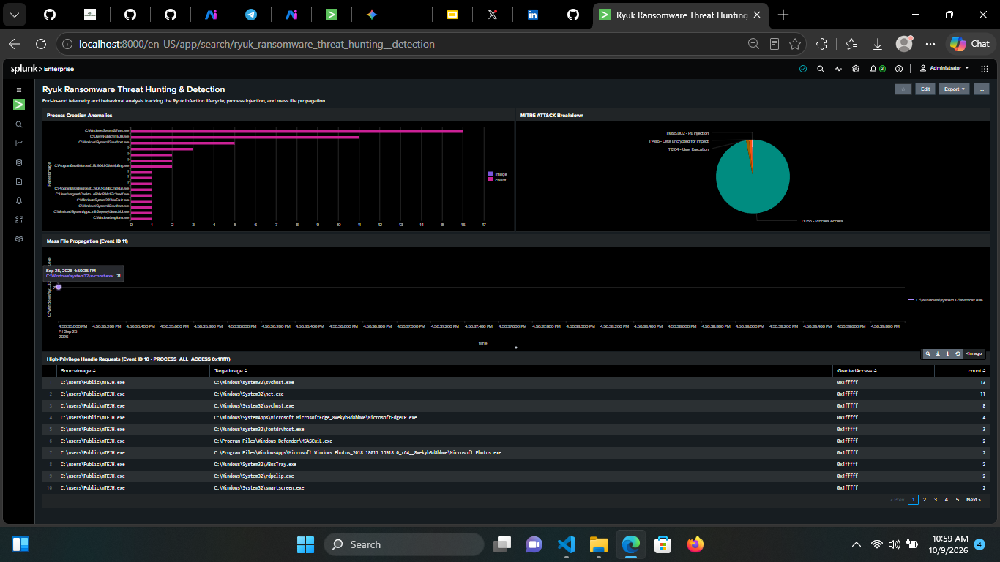
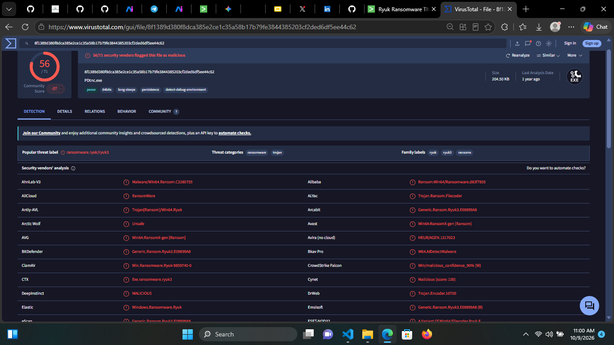
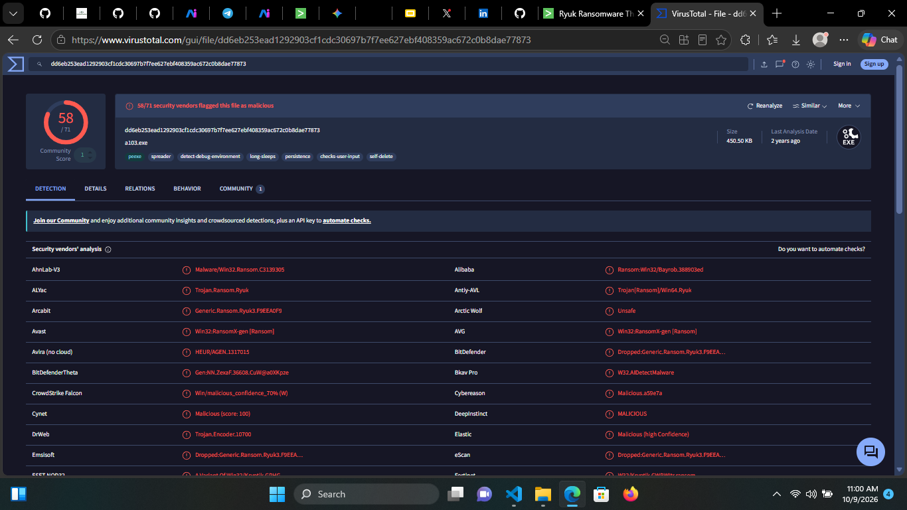

# Ryuk Ransomware Investigation

> **The uncomfortable truth:** ransomware does not need to break into every door when it can convince a trusted Windows service to hold one open. In this case file, familiar system tools and processes become accomplices—first clearing the runway, then helping the intrusion hide in plain sight.

This is a simulated, telemetry-led investigation of a Ryuk ransomware deployment in a Windows lab. We start with a compatibility artifact, rewind the clock, and follow the chain from a desktop-launched executable to a staged loader, suspicious process access, remote-thread activity, service tampering, and a blizzard of ransom notes.

**Case:** `INC-2026-RYUK-01` · **Anchor:** `2026-09-25 16:50:38 UTC` · **Primary telemetry:** Windows Sysmon in Splunk

> **Analyst Note:** The telemetry shows a fast-moving chain, but it does **not** include direct file-encryption evidence or prove that every process-access event led to successful injection. Good incident response distinguishes evidence from inference—even when the inference is wearing a very suspicious hat.

## Executive summary

A user launched `14248fda59e7a8bf9f143abe8bbd834cb7c2aa4f.exe` from the desktop. It dropped `mTEJH.exe` into the shared `C:\Users\Public\` directory. Around the same time, the loader requested `0x1fffff` process handles, created remote threads in legitimate processes, and invoked native Windows utilities to stop services. File-creation telemetry then showed `C:\Windows\system32\svchost.exe` rapidly writing `RyukReadMe.html` into many locations.

The operational story is a familiar one: **user execution → staging → service interference → process injection activity → ransom-note propagation**. Each step leaves a different trail; the useful signal appears when those trails are correlated in a tight time window rather than treated as isolated alerts.

## Choose your next pivot

Pick a trail, then follow it into the telemetry:

1. **“Where did this start?”** → [Anchor artifact & timeline](#the-first-clue-anchor-artifact)
2. **“What did the loader touch?”** → [Process access and injection](#the-camouflage-process-access--remote-threads)
3. **“How wide did the impact spread?”** → [Ransom-note propagation](#the-impact-ransom-note-propagation)
4. **“Show me the searches.”** → [Splunk dashboard & SPL](#splunk-threat-hunting-dashboard--telemetry)
5. **“Can we validate the samples?”** → [VirusTotal artifacts](#virustotal-proof-of-concept-artifacts)

## How I start a hunt

Whenever I receive a log file, the first thing I do is check what telemetry is available. I inventory the Sysmon Event IDs before chasing a suspicious filename: this dataset contains Events **1, 5, 8, 10, 11, 13, and 22**. That quickly tells me which questions the logs can answer—and which ones they cannot.

From there, I start with **Event ID 13**. The AppCompatFlags artifact points to the desktop executable and gives me an anchor timestamp: `2026-09-25 16:50:38 UTC`. I use that clue to pivot into nearby process creation, process access, remote-thread, and file-creation events. Starting at the registry breadcrumb turns a pile of XML into a timeline.

Want to reproduce the hunt? [Download the raw Sysmon log](./windows-sysmon.txt) and run the SPL searches below in Splunk.

## The first clue: anchor artifact

Sysmon **Event ID 13 (RegistryEvent)** recorded a Windows Compatibility Assistant entry for the suspicious desktop executable. The artifact is a useful execution breadcrumb and gives us the timestamp to pivot around; by itself, it is not proof of persistence.

```text
HKU\S-1-5-21-...-1000\Software\Microsoft\Windows NT\CurrentVersion\AppCompatFlags\Compatibility Assistant\Store\C:\Users\vagrant\Desktop\14248fda59e7a8bf9f143abe8bbd834cb7c2aa4f.exe
```

**Anchor time:** `2026-09-25 16:50:38 UTC`. The process and file pivots use a two-minute window: **60 seconds before through 60 seconds after** the anchor.

### Reconstructed timeline

| Time | Evidence | Why we care |
|---|---|---|
| `16:50:38` | Event ID 13 AppCompatFlags artifact references the desktop executable. | A timestamped lead to pivot from; not a persistence verdict. |
| `T+0.00s` | The desktop staging binary executes. | User execution starts the chain. |
| `T+0.00s to +0.02s` | The staging binary drops `C:\Users\Public\mTEJH.exe`. | A second-stage binary appears in a broadly accessible location. |
| `T+0.02s to +0.05s` | `mTEJH.exe` requests `0x1fffff` handles and iterates over processes. | High-access process requests are suspicious in context, but not proof of successful injection alone. |
| `T+0.05s` | Service commands and mass file-creation activity appear in the telemetry. | Service interference and ransom-note writes mark escalation and impact. |

The loader re-launched the original desktop executable with this command line:

```text
"C:\users\Public\mTEJH.exe" C:\Users\vagrant\Desktop\14248fda59e7a8bf9f143abe8bbd834cb7c2aa4f.exe
```

Other Event ID 1 findings include `net1 stop "samss" /y`, `net1 stop "audioendpointbuilder" /y`, and `rundll32.exe` loading `chakra.dll`. Investigate parent/child relationships and the full command line before treating a matching command as malicious.

> **Analyst Note:** A timestamp is a compass, not a confession. Keep the window tight enough to preserve causality, then widen it if the host’s clock, ingestion delay, or event volume calls for it.

## Interactive quick checks

Pause before opening the answer. Your incident-response instincts are the point of the exercise.

<details>
<summary><strong>Quick check 1:</strong> Event ID 10 shows GrantedAccess = <code>0x1fffff</code>. What is the best next move?</summary>

- A. Declare confirmed process injection and isolate every process in the event.
- B. Treat it as a high-risk process-access signal; correlate source and target, then look for Event ID 8 and process context.
- C. Ignore it unless the target is `lsass.exe`.

**Best answer: B.** `0x1fffff` is the Windows `PROCESS_ALL_ACCESS` mask in the relevant Sysmon representation. It grants extensive process rights, but an access request is not proof that code was written or executed. Establish who requested access, which process was targeted, whether access succeeded where available, and whether a corresponding remote-thread event follows.

</details>

<details>
<summary><strong>Quick check 2:</strong> Event ID 8 shows a remote thread from <code>mTEJH.exe</code> into a trusted process. Is that enough to claim PE injection?</summary>

- A. Yes. Event ID 8 proves the injected payload type.
- B. No. It is strong injection-related evidence; corroborate with process-access, memory, image-load, and endpoint evidence before naming the exact injection method.
- C. No. Remote threads are always normal Windows behavior.

**Best answer: B.** This activity is consistent with `T1055.002`, but Sysmon Event ID 8 alone does not establish every implementation detail or prove the thread’s payload.

</details>

<details>
<summary><strong>Quick check 3:</strong> What does a burst of <code>RyukReadMe.html</code> writes from <code>svchost.exe</code> tell you?</summary>

- A. The ransom-note activity is consistent with impact; inspect file paths, cadence, process ancestry, and injection evidence.
- B. Encryption is conclusively confirmed.
- C. It is benign because `svchost.exe` is signed by Microsoft.

**Best answer: A.** The observed note propagation is a high-value behavioral indicator. The listed telemetry does not itself prove that user files were encrypted, and a trusted process name is not a trust verdict.

</details>

## What the evidence says

### The spark: user execution & staging

The initial sample, `14248fda59e7a8bf9f143abe8bbd834cb7c2aa4f.exe`, ran from:

```text
C:\Users\vagrant\Desktop\14248fda59e7a8bf9f143abe8bbd834cb7c2aa4f.exe
```

It dropped the loader at:

```text
C:\Users\Public\mTEJH.exe
```

The desktop launch is consistent with **MITRE ATT&CK T1204 (User Execution)**. Staging the loader is consistent with **T1105 (Ingress Tool Transfer)**. Validate technique mappings against the full event context before operationalizing detections.

### The pivot: service tampering & proxy execution

The Event ID 1 findings include:

```text
net1 stop "samss" /y
net1 stop "audioendpointbuilder" /y
rundll32.exe ... chakra.dll
```

Service changes are consistent with **T1562.001 (Impair Defenses: Disable or Modify Tools)**, while the `rundll32.exe` / `chakra.dll` activity is consistent with **T1218.011 (Signed Binary Proxy Execution: Rundll32)**. Treat these as behaviors to investigate—not standalone verdicts; native utilities also have legitimate administrative uses.

### The camouflage: process access & remote threads

**Sysmon Event ID 10 (ProcessAccess)** showed `mTEJH.exe` requesting `0x1fffff` access against multiple system and user-space processes. Examples include `smartscreen.exe`, `VBoxTray.exe`, and browser broker processes.

**Sysmon Event ID 8 (CreateRemoteThread)** then recorded remote-thread activity attributed to `mTEJH.exe` in legitimate processes, including SmartScreen, Photos, Edge helper, and tray utilities. Event ID 10 activity is consistent with **T1055 (Process Injection)**, and the Event ID 8 behavior is consistent with **T1055.002 (Portable Executable Injection)**.

> **Analyst Note:** `PROCESS_ALL_ACCESS` is a loud knock. Event ID 8 is the follow-up at the door. Correlate both—and verify the target process, time, and telemetry quality—before you write “injection confirmed” in the incident channel.

### The impact: ransom-note propagation

**Sysmon Event ID 11 (FileCreate)** showed rapid creation of `RyukReadMe.html` files attributed to:

```text
C:\Windows\system32\svchost.exe
```

The destinations include user profiles, Start Menu directories, application folders, system directories, and device metadata caches. This extortion/notification behavior is associated with **T1486 (Data Encrypted for Impact)**. However, ransom-note creation is not direct evidence of encryption; validate encryption separately using file telemetry, endpoint evidence, or recovery artifacts.

### Sysmon telemetry in scope

| Event ID | Sysmon event | Use in this investigation |
|---:|---|---|
| 1 | Process Create | Initial execution, loader command line, service commands, `rundll32.exe` activity |
| 5 | Process Terminated | Process termination pivot; available in the dataset |
| 8 | CreateRemoteThread | Remote-thread activity correlated with the loader |
| 10 | ProcessAccess | High-privilege process-handle requests |
| 11 | FileCreate | Loader drop and ransom-note propagation |
| 13 | RegistryEvent | AppCompatFlags execution artifact and timestamp anchor |
| 22 | DNS Query | Available for DNS pivots; no specific DNS IOC was identified in this investigation |

## Splunk Threat Hunting Dashboard & Telemetry

The raw Sysmon XML is indexed in Splunk as `index="main"` and `sourcetype="ryuk"`, without automatic field extraction. The searches below extract fields with `rex` and use the investigation anchor timestamp. In production, parameterize the time picker / anchor and confirm the Splunk timezone against the endpoint clock.

> **Analyst Note:** The first, third, and fourth panels are direct event-level hunts; the MITRE panel summarizes behaviors by technique. Tune the anchor time and field extraction to your own Splunk environment before turning a hunt into an alert.

### Start here — event inventory and registry anchor

Count available Sysmon Event IDs to establish what the logs can tell you:

```spl
index="main" sourcetype="ryuk"
| rex field=_raw "<EventID>(?<EventID>\d+)</EventID>"
| stats count by EventID
| sort -count
```

Pivot into registry modifications and identify common target objects:

```spl
index="main" sourcetype="ryuk"
| rex field=_raw "<EventID>(?<EventID>\d+)</EventID>"
| search EventID=13
| rex field=_raw "<Data Name='TargetObject'>(?<TargetObject>[^<]+)</Data>"
| stats count by TargetObject
| sort -count
```

Expand the AppCompatFlags execution artifact and its details:

```spl
index="main" sourcetype="ryuk"
| rex field=_raw "<EventID>(?<EventID>\d+)</EventID>"
| search EventID=13
| rex field=_raw "<Data Name='TargetObject'>(?<TargetObject>[^<]+)</Data>"
| rex field=_raw "<Data Name='Details'>(?<Details>[^<]+)</Data>"
| search TargetObject="*AppCompatFlags\\Compatibility Assistant\\Store*"
| table _time Computer TargetObject Details
```

### Panel 1 — Process Anomalies (Event ID 1)

Process creation within ±60 seconds of the AppCompatFlags anchor, with Splunk processes excluded:

```spl
index="main" sourcetype="ryuk"
| rex field=_raw "<EventID>(?<EventID>\d+)</EventID>"
| search EventID=1
| eval event_time=_time
| where event_time >= relative_time(strptime("2026-09-25 16:50:38", "%Y-%m-%d %H:%M:%S"), "-60s")
  AND event_time <= relative_time(strptime("2026-09-25 16:50:38", "%Y-%m-%d %H:%M:%S"), "+60s")
| rex field=_raw "<Data Name='Image'>(?<Image>[^<]+)</Data>"
| rex field=_raw "<Data Name='CommandLine'>(?<CommandLine>[^<]+)</Data>"
| where NOT match(Image, "Splunk")
| table _time Image CommandLine
```

### Panel 2 — MITRE ATT&CK Breakdown

Technique counts derived from the observed event patterns. This is an investigative classification, not a claim that every matching event independently confirms a technique.

```spl
index="main" sourcetype="ryuk"
| rex field=_raw "<EventID>(?<EventID>\d+)</EventID>"
| rex field=_raw "<Data Name='Image'>(?<Image>[^<]+)</Data>"
| rex field=_raw "<Data Name='CommandLine'>(?<CommandLine>[^<]+)</Data>"
| rex field=_raw "<Data Name='SourceImage'>(?<SourceImage>[^<]+)</Data>"
| rex field=_raw "<Data Name='TargetImage'>(?<TargetImage>[^<]+)</Data>"
| rex field=_raw "<Data Name='GrantedAccess'>(?<GrantedAccess>[^<]+)</Data>"
| rex field=_raw "<Data Name='TargetFilename'>(?<TargetFilename>[^<]+)</Data>"
| eval Technique_ID=case(
    EventID="1" AND match(Image, "(?i)14248fda59e7a8bf9f143abe8bbd834cb7c2aa4f\.exe"), "T1204",
    EventID="11" AND match(TargetFilename, "(?i)mTEJH\.exe"), "T1105",
    EventID="10" AND match(GrantedAccess, "(?i)^0x0*1fffff$")
      AND (match(SourceImage, "(?i)(14248fda59e7a8bf9f143abe8bbd834cb7c2aa4f|mTEJH)\.exe")
        OR match(TargetImage, "(?i)(14248fda59e7a8bf9f143abe8bbd834cb7c2aa4f|mTEJH)\.exe")), "T1055",
    EventID="8" AND match(SourceImage, "(?i)mTEJH\.exe"), "T1055.002",
    EventID="1" AND match(Image, "(?i)\\net1?\.exe$")
      AND match(CommandLine, "(?i)stop.*(samss|audioendpointbuilder)"), "T1562.001",
    EventID="1" AND match(Image, "(?i)rundll32\.exe") AND match(CommandLine, "(?i)chakra\.dll"), "T1218.011",
    EventID="11" AND match(TargetFilename, "(?i)RyukReadMe\.html$"), "T1486"
  )
| where isnotnull(Technique_ID)
| stats count AS detections by Technique_ID
| sort - detections
```

### Panel 3 — Mass File Propagation (Event ID 11)

The file-creation pivot scoped to the anchor window:

```spl
index="main" sourcetype="ryuk"
| rex field=_raw "<EventID>(?<EventID>\d+)</EventID>"
| search EventID=11
| eval event_time=_time
| where event_time >= relative_time(strptime("2026-09-25 16:50:38", "%Y-%m-%d %H:%M:%S"), "-60s")
  AND event_time <= relative_time(strptime("2026-09-25 16:50:38", "%Y-%m-%d %H:%M:%S"), "+60s")
| rex field=_raw "<Data Name='Image'>(?<Image>[^<]+)</Data>"
| rex field=_raw "<Data Name='TargetFilename'>(?<TargetFilename>[^<]+)</Data>"
| table _time Image TargetFilename
```

For a chart-oriented view of ransom-note counts by writing process, append:

```spl
| search TargetFilename="*RyukReadMe.html"
| stats count AS note_writes by Image
| sort - note_writes
```

### Panel 4 — High-Privilege Handle Requests (`0x1fffff`, Event ID 10)

This binary-focused Event ID 10 search narrows results to the `PROCESS_ALL_ACCESS` mask:

```spl
index="main" sourcetype="ryuk"
| rex field=_raw "<EventID>(?<EventID>\d+)</EventID>"
| search EventID=10
| rex field=_raw "<Data Name='SourceImage'>(?<SourceImage>[^<]+)</Data>"
| rex field=_raw "<Data Name='TargetImage'>(?<TargetImage>[^<]+)</Data>"
| rex field=_raw "<Data Name='GrantedAccess'>(?<GrantedAccess>[^<]+)</Data>"
| where match(SourceImage, "(?i)(14248fda59e7a8bf9f143abe8bbd834cb7c2aa4f|mTEJH)\.exe")
   OR match(TargetImage, "(?i)(14248fda59e7a8bf9f143abe8bbd834cb7c2aa4f|mTEJH)\.exe")
| where match(GrantedAccess, "(?i)^0x0*1fffff$")
| table _time SourceImage TargetImage GrantedAccess
```

### Additional pivots — remote threads and process termination

Correlate Sysmon **Event ID 8 (CreateRemoteThread)** with the same anchor window:

```spl
index="main" sourcetype="ryuk"
| rex field=_raw "<EventID>(?<EventID>\d+)</EventID>"
| search EventID=8
| eval event_time=_time
| where event_time >= relative_time(strptime("2026-09-25 16:50:38", "%Y-%m-%d %H:%M:%S"), "-60s")
  AND event_time <= relative_time(strptime("2026-09-25 16:50:38", "%Y-%m-%d %H:%M:%S"), "+60s")
| rex field=_raw "<Data Name='SourceImage'>(?<SourceImage>[^<]+)</Data>"
| rex field=_raw "<Data Name='TargetImage'>(?<TargetImage>[^<]+)</Data>"
| table _time SourceImage TargetImage
```

Check for process termination activity around the anchor with **Event ID 5**:

```spl
index="main" sourcetype="ryuk"
| rex field=_raw "<EventID>(?<EventID>\d+)</EventID>"
| search EventID=5
| eval event_time=_time
| where event_time >= relative_time(strptime("2026-09-25 16:50:38", "%Y-%m-%d %H:%M:%S"), "-60s")
  AND event_time <= relative_time(strptime("2026-09-25 16:50:38", "%Y-%m-%d %H:%M:%S"), "+60s")
| rex field=_raw "<Data Name='Image'>(?<Image>[^<]+)</Data>"
| table _time Image
```

### Splunk dashboard



## Official Investigation Report

👉 [Download Full Ryuk Case Study PDF](./reports/Ryuk_Malware_Investigation_Report.pdf)

## VirusTotal Proof of Concept Artifacts

These sample hashes and VirusTotal detection ratios provide IOC validation leads. Detection ratios may change as vendors update their verdicts.

| Artifact | SHA-256 | Detections | VirusTotal |
|---|---|---:|---|
| Loader: `mTEJH.exe` | `8f1389d380f8dca385e2ce1c35a58b17b79fe3844385203cf2ded6df5ee44c62` | **56 / 71** | [File report](https://www.virustotal.com/gui/file/8f1389d380f8dca385e2ce1c35a58b17b79fe3844385203cf2ded6df5ee44c62) · [Behavior tab](https://www.virustotal.com/gui/file/8f1389d380f8dca385e2ce1c35a58b17b79fe3844385203cf2ded6df5ee44c62/behavior) |
| Desktop payload: `14248fda59e7a8bf9f143abe8bbd834cb7c2aa4f.exe` (`a103.exe`) | `dd6eb253ead1292903cf1cdc30697b7f7ee627ebf408359ac672c0b8dae77873` | **58 / 71** | [File report](https://www.virustotal.com/gui/file/dd6eb253ead1292903cf1cdc30697b7f7ee627ebf408359ac672c0b8dae77873) · [Behavior tab](https://www.virustotal.com/gui/file/dd6eb253ead1292903cf1cdc30697b7f7ee627ebf408359ac672c0b8dae77873/behavior) |

Loader behaviors: `peexe`, `64bits`, `long-sleeps`, `persistence`, and `detect-debug-environment`.

Desktop-payload behaviors: `peexe`, `spreader`, `detect-debug-environment`, `long-sleeps`, `persistence`, `checks-user-input`, and `self-delete`.

VirusTotal sandbox and detection evidence:





🔗 [View VirusTotal IOC Scan Link](https://www.virustotal.com/gui/file/YOUR_HASH_HERE) — replace `YOUR_HASH_HERE` with either SHA-256 above when reusing this generic link.

> **Safe handling:** These are malicious sample indicators. Do not download or execute the files on a production endpoint. Use hash lookups and isolated analysis environments only.

## MITRE ATT&CK mapping

| Activity | Technique | Evidence in this case |
|---|---|---|
| Initial execution | [T1204 — User Execution](https://attack.mitre.org/techniques/T1204/) | Desktop-launched staging binary |
| Payload staging | [T1105 — Ingress Tool Transfer](https://attack.mitre.org/techniques/T1105/) | `mTEJH.exe` written under `C:\Users\Public\` |
| Process access / injection activity | [T1055 — Process Injection](https://attack.mitre.org/techniques/T1055/) | Event ID 10 requests for `0x1fffff` |
| Remote-thread injection | [T1055.002 — Portable Executable Injection](https://attack.mitre.org/techniques/T1055/002/) | Event ID 8 remote-thread activity attributed to the loader |
| Defense impairment | [T1562.001 — Disable or Modify Tools](https://attack.mitre.org/techniques/T1562/001/) | `net1 stop` service commands in Event ID 1 |
| Proxy execution | [T1218.011 — Rundll32](https://attack.mitre.org/techniques/T1218/011/) | `rundll32.exe` observed loading `chakra.dll` |
| Impact | [T1486 — Data Encrypted for Impact](https://attack.mitre.org/techniques/T1486/) | Ransom-note propagation is consistent with an impact phase; encryption is not directly demonstrated by the cited events |

## Analyst takeaways

- **Behavior beats filenames.** Rare parent/child relationships and timing often reveal a loader faster than a static-name blocklist.
- **Correlate before concluding.** Event ID 10 plus Event ID 8 is a stronger story than either event alone, but memory or endpoint evidence is needed to substantiate exact injection mechanics.
- **A trusted process can still be abused.** Investigate the behavior and provenance of `svchost.exe`; the image name is not a benignness certificate.
- **Separate impact indicators.** Ransom-note creation signals an extortion phase. Confirm encryption with independent evidence.
- **Tune the hunt to your environment.** Validate raw XML field names, timestamp timezone, event coverage, and Splunk extraction behavior before using these searches as production detections.

---

*Investigation complete. The strongest detections come from correlating execution, process access, remote-thread activity, and file creation—not from trusting a process name or a single event in isolation.*
